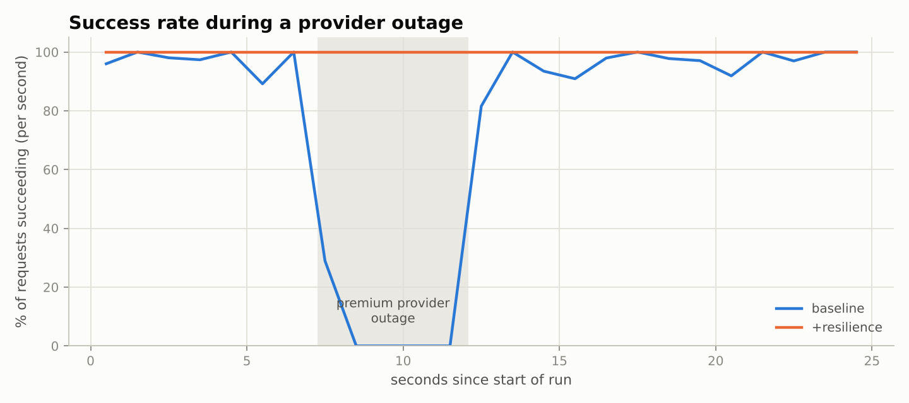
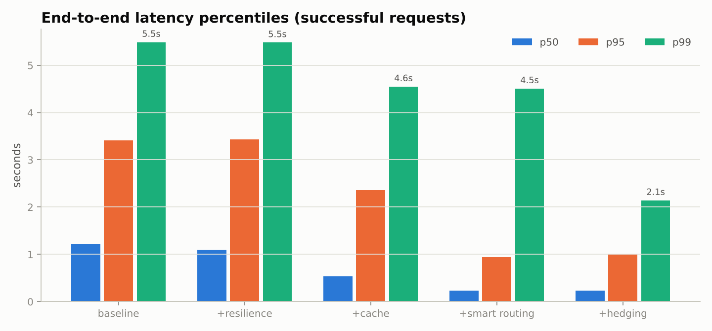
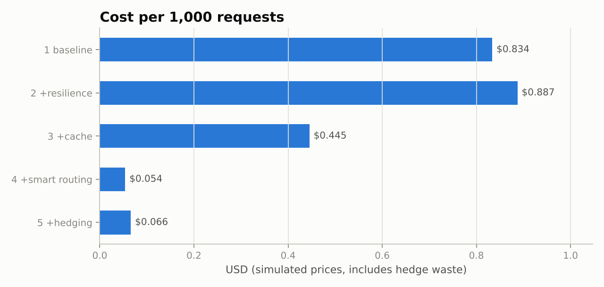
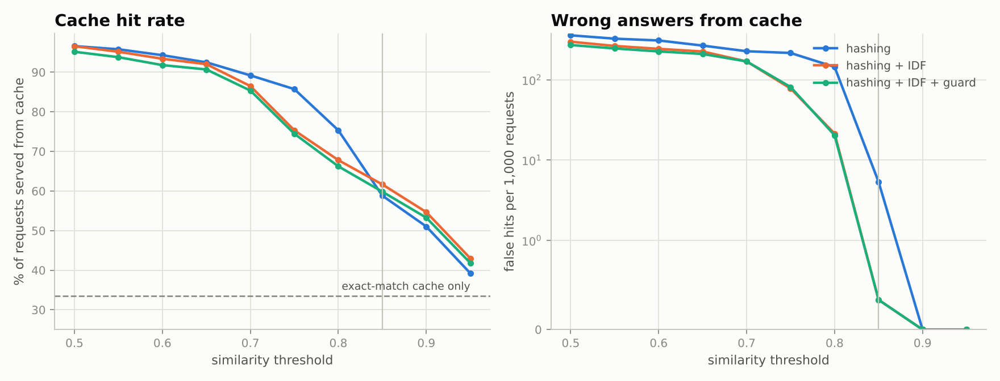

# Conduit

[](https://pypi.org/project/lochangowda10-conduit/)
[](https://pypi.org/project/lochangowda10-conduit/)
[](https://pypi.org/project/lochangowda10-conduit/)
[](LICENSE)
[](https://github.com/lochangowda10/Conduit)

**A self-hosted, OpenAI-compatible LLM gateway that makes LLM calls cheaper, more reliable and faster.**
Point any OpenAI-SDK app at it by changing one URL; Conduit adds semantic caching, complexity-based
model routing, retries with circuit breakers and fallback, hedged requests, rate limiting, a spending cap,
and per-request cost/latency analytics.

```python
from openai import OpenAI
client = OpenAI(base_url="http://localhost:8080/v1", api_key="anything")
client.chat.completions.create(model="auto", messages=[{"role": "user", "content": "Hi!"}])
```

## Results

Benchmark: 1,000 requests per configuration, Poisson arrivals at 40 req/s, three **simulated** providers
(log-normal latency, 2% 5xx, 1% 429, 4% multi-second stalls), with the premium provider **down for
30–50% of every run**. Reproduce with `conduit bench` then `conduit report`.

| Configuration | Success | Cache hits | p50 | p95 | p99 | Cost / 1k req |
|---|---|---|---|---|---|---|
| 1 baseline (one premium model) | 76.1% | – | 1.23 s | 3.42 s | 5.49 s | $0.834 |
| 2 + retries, breakers, fallback | **100%** | – | 1.10 s | 3.43 s | 5.48 s | $0.887 |
| 3 + exact & semantic cache | 100% | 43.5% | 0.54 s | 2.36 s | 4.55 s | $0.445 |
| 4 + complexity routing | 100% | 44.3% | 0.23 s | 0.94 s | 4.51 s | $0.054 |
| 5 + hedged requests (full) | **100%** | 44.4% | **0.24 s** | 1.00 s | **2.14 s** | **$0.066** |

- **92% lower cost** than the baseline, **100% success** through the outage (baseline: 76.1%).
- **Hedging halves p99** (4.51 s → 2.14 s) for 22% more cost; only 3.7% of requests are hedged.
- **Semantic cache**: 2 wrong answers in 1,000 requests. A labelled threshold sweep picked 0.85:
  ~60% hit rate vs 34% for exact matching, at 0.33 wrong answers per 1,000.

| | |
|---|---|
|  |  |
|  |  |

Numbers come from simulated providers and a synthetic workload (80% repeated questions in varied
phrasings, 20% one-off prompts); savings depend on how much of real traffic is simple or repeated.

## How a request flows

```
client ─► HTTP server ─► 1 cache ──hit──► answer (0.15 ms exact / 2.6 ms semantic, $0)
                             │ miss
                             ▼
                         2 admit   token-bucket rate limit, spending cap
                         3 route   complexity tier → rank by price, EWMA latency, error rate
                         4 call    fallback chain · circuit breakers · @retry · hedging ─► providers
                         5 record  cache put · cost ledger · JSONL log ─► Pandas / Matplotlib reports
```

## Features

- **Two-level cache**: SHA-256 exact match, then a NumPy semantic match (hashing-trick embeddings,
  query-time IDF weighting, cosine similarity, entity guard for numbers/names), scoped by system prompt,
  model and temperature; LRU + TTL; only low-temperature requests are cached.
- **Routing**: transparent complexity score → tier; capable providers ranked by weighted price,
  EWMA latency and error rate; weaker tiers kept as a last resort.
- **Resilience**: retries with full-jitter exponential backoff (only for retryable errors, honours
  `Retry-After`), per-provider circuit breakers, lazy fallback chain, streaming fallback before the first token.
- **Hedged requests**: race an equally capable backup when the primary is slow; the loser's cost is
  recorded as hedge waste.
- **Admission control**: thread-safe token bucket and a spending cap (cache hits still served).
- **Providers**: simulated (offline, injectable outages), any OpenAI-compatible API (OpenAI, Groq,
  Gemini, OpenRouter, ...), local servers (Ollama, LM Studio).
- **Observability**: JSONL request logs, `/metrics`, Pandas summaries, six Matplotlib charts.
- **Zero heavy dependencies**: standard-library HTTP; NumPy, Pandas, Matplotlib.

## Installation

```bash
pip install lochangowda10-conduit
```

## Quick start

```bash
conduit stats                # cache + routing demo
conduit serve                # gateway on http://127.0.0.1:8080/v1
conduit tour                 # every course concept, demonstrated live
conduit bench                # run the benchmark against simulated providers
conduit report               # draw charts from the last benchmark run
```

Real providers: `cp config.example.json config.json`, export `GROQ_API_KEY` / `GEMINI_API_KEY`,
check model IDs and prices in each provider's docs, then `conduit serve --config config.json`.

## Development install

```bash
git clone https://github.com/lochangowda10/Conduit.git
cd Conduit
pip install -e ".[dev]"
python -m pytest -q          # 83 tests
```

## Design decisions

| Decision | Why |
|---|---|
| Hashing-trick embeddings (neural embedder optional) | Runs on any laptop with no model download; recall cost measured in `benchmarks/cache_eval.py` |
| Threshold chosen by wrong-answer rate, not hit rate | A wrong cached answer is worse than a slow one |
| Hedge only to an equal-or-stronger tier | A faster, weaker model would otherwise win and silently lower quality |
| Threads, not asyncio | Workload is I/O-bound (threads release the GIL while waiting); blocking stdlib clients; simpler at this scale |
| Open-loop load generator | A closed loop sent extra traffic during the outage and hid queueing delay |
| Typed error hierarchy | Retry decisions by exception type, never by parsing messages |

## Project layout

```
conduit/            gateway package
  gateway.py        the pipeline, hedging, streaming
  cache.py          exact + semantic cache
  embeddings.py     hashing-trick embedder (+ optional sentence-transformers)
  router.py         strategies, complexity score, FallbackChain iterator
  resilience.py     @retry, @log_execution, CircuitBreaker
  ratelimit.py      TokenBucket
  ledger.py         thread-safe cost ledger
  telemetry.py      JSONL logs, CSV export
  analytics.py      Pandas summaries
  server.py         OpenAI-compatible HTTP server (SSE streaming)
  providers/        ABC + mixins, simulated, OpenAI-compatible, local
benchmarks/         workload generator, benchmark, cache sweep, charts
demos/              course concept tour, race-condition + GIL demo
tests/              83 pytest tests (incl. end-to-end over real HTTP)
results/            benchmark CSVs and charts
```

## Limitations

Single process (state in memory); heuristic router calibrated on synthetic prompts; estimated token
counts when a provider doesn't report usage; no request coalescing for concurrent identical misses;
hashing embeddings can confuse long prompts that differ by one word.

## Support the project

If you find Conduit useful, please consider:

- **Starring the repository** so others can discover it: https://github.com/lochangowda10/Conduit
- **Reporting bugs and suggesting features** via [GitHub Issues](https://github.com/lochangowda10/Conduit/issues)
- **Sharing it** with your team or writing about it
- **Contributing** code, tests, or docs — see [CONTRIBUTING.md](CONTRIBUTING.md)

## Contributing

Contributions are welcome! Please read [CONTRIBUTING.md](CONTRIBUTING.md) and our
[Code of Conduct](CODE_OF_CONDUCT.md) before opening a pull request.

## License

Released under the [MIT License](LICENSE). © 2026 Lochan Gowda.
